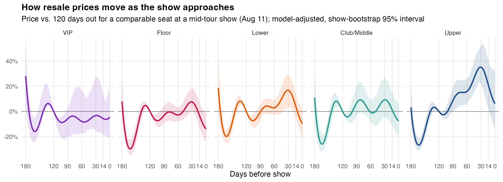

# The Beyconomics of Ticket Buying

A data-driven analysis of the resale ticket market for Beyoncé's 2023 Renaissance World
Tour: **when and where should you buy?** Built on about 56,000 resale sales at 29 North
American stadium shows, February–October 2023.

**[Try the interactive page →](https://ememercy21.github.io/beyonce-ticket-analysis/)**
Pick a show and a seat tier to see how prices moved before the show, check whether a ticket
was a good deal, and compare shows.

## Key findings

- **Don't buy a month out.** For a comparable seat, resale prices peaked about 30 days
  before the show. Waiting until the final week was 12–18% cheaper, and buying on show day
  was 15–23% cheaper, across Floor, Lower, Club/Middle and Upper seats. The 95% ranges come
  from refitting the model on resampled shows, and they exclude zero in all four tiers.
- **Early March was a tour-wide low.** About 5 months before a mid-tour show, prices were
  about 20–30% below their 4-month-out level in every main tier. This was a market-wide
  slump after the February on-sale, not a reason to buy 5 months early.
- **Which show you pick matters as much as when you buy.** After adjusting for seat and
  timing, a comparable seat cost about 50–70% more at Santa Clara or Charlotte and about
  30–50% less at Phoenix, Minneapolis or Las Vegas (night 2) than at a typical show.
- **VIP packages don't get cheaper late.** VIP is split into packages with their own price
  levels (vs. Club Renaissance: B-Hive +64%, risers +217%, VIP floor +365%). With the
  package mix accounted for, VIP prices barely moved in the final month (−1% from 30 days
  out to show day). The range is wide because there are only 348 VIP sales.



Full results: [`reports/model_results.md`](reports/model_results.md) ·
Data cleaning: [`reports/data_quality.md`](reports/data_quality.md)

## What changed from v1

The first version (June 2025, STATS 404) is in [`archive/v1/`](archive/v1/). The rework
fixed three problems that changed its conclusions:

- **Duplicate data.** 7 of the 36 per-show files were byte-identical copies of other shows
  (for example, "St. Louis" was Miami's data). About 18% of rows were duplicates, so some
  city results were really another city's prices. The rebuilt pipeline detects identical
  files and refuses to run until each one is resolved.
- **A circular deal score.** v1 multiplied a price-based "seat quality" score into the deal
  score, so expensive sections scored higher by design. Its finding that premium sections
  had the highest deal probability came from that. The new score never uses seat price
  directly, and every tier averages about 50.
- **Optimistic validation.** v1 scored models on their own training data or on random rows.
  The new model is tested on held-out cities and held-out sales.

## Method

- **Model:** a generalized additive model (GAM) of log price on seat tier, VIP package, row,
  ticket quantity and show features (weekend, multi-night city, later night, Canada), plus a
  timing curve for each tier, a tour-wide calendar trend and a random effect per show.
- **Validation:** (1) leave-one-city-out, predicting a tour stop the model has never seen:
  median error about 31%. (2) 10-fold CV within known shows: median error 24% (about $81 per
  ticket), and each added term improves it.
- **Deal score (0–100):** the percentile of how far below the model's expected price a sale
  was, given its tier, show, row, quantity and day.
- **Timing:** within one show, days-before and calendar date move together, so the curves
  follow a buyer of a typical mid-tour show (Aug 11). Ranges come from 200 refits on
  resampled shows.

## Data

- **Source:** [SeatData.io](https://seatdata.io), one resale price-history export per show.
- Rows appear to be **completed resale sales** (time, section, row, quantity, price per
  ticket), not listing snapshots. Timestamps are US Eastern time.
- **No usable data** for Philadelphia, St. Louis, Kansas City, LA 9/2, Atlanta 8/14 or
  Houston 9/24 (their files were copies of other shows).
- `seat_tier` (VIP / Floor / Lower / Club/Middle / Upper / Suite) is mapped from each
  stadium's own zone names by the rules in [`R/seat_tiers.R`](R/seat_tiers.R).
- Toronto and Vancouver prices may be in Canadian dollars; the export doesn't say.

## Repository layout

```
index.html             the interactive page (served by GitHub Pages)
data/raw/listings/     one SeatData.io export per show (never edited)
data/raw/show_manifest.csv  city, date and keep/drop decision for each raw file
R/
  01_build_data.R      raw files -> clean dataset + data quality report
  02_model.R           price model, validation, timing curves, deal score
  03_export_web.R      model results -> web/data.json (with show bootstrap)
  04_build_page.R      embeds the data into web/template.html -> index.html
  seat_tiers.R         venue zone names -> comparable seat tiers and VIP packages
reports/               generated results and figures
web/template.html      source of the interactive page (edit this, not index.html)
archive/v1/            the original analysis, slides and paper
```

## Reproduce

```bash
Rscript R/01_build_data.R
Rscript R/02_model.R       # about 1 minute (200 bootstrap refits)
Rscript R/03_export_web.R  # about 1 minute
Rscript R/04_build_page.R
```

Needs R ≥ 4.1 with `dplyr`, `readr`, `stringr`, `purrr`, `tidyr`, `here`, `mgcv`, `ggplot2`,
`scales`, `MASS` and `jsonlite`. Generated files (`data/processed/`, `models/`,
`web/data.json`) are not committed.

## Limitations

- One artist and one tour; results may not carry over to other tours.
- Resale sales only, with no primary sales or presales. Seats still for sale near show day
  may be worse seats within a tier.
- 29 shows is a small sample for show-level effects such as the weekend premium.

## Author

**Mercy Eme**

## Acknowledgments

Data sourced from SeatData.io. Inspired by the chaos of trying to get Beyoncé tickets like
a normal person.
