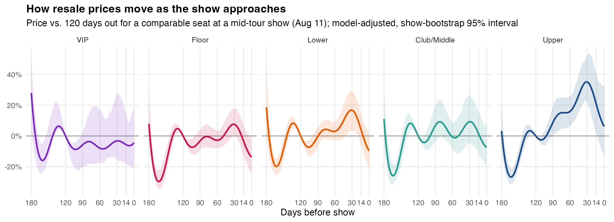
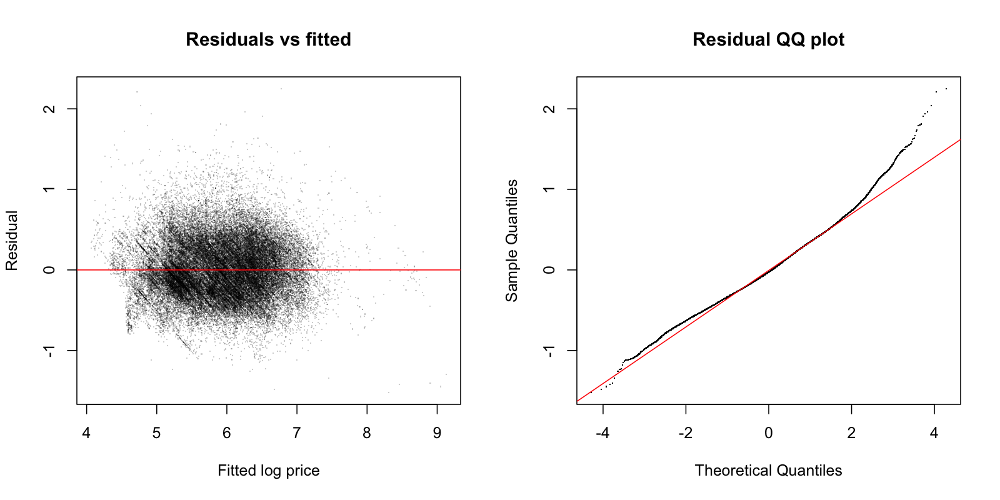

# Model results

Generated by `R/02_model.R` on 2026-11-06. 55,813 sales across 29 shows (the 27 `Other`-tier rows are excluded).

## Model comparison: leave-one-city-out cross-validation

Each city is held out in turn and predicted by a model trained on the other 21.
`mdae_usd` is the median absolute error in dollars per ticket.

| model | rmse_log | r2_log | mdae_usd | mape_pct |
| --- | --- | --- | --- | --- |
| 1. Seat tier only | 0.5 | 0.485 | 115.921 | 33.091 |
| 2. + show & seat features | 0.473 | 0.54 | 107.886 | 31.67 |
| 3. + timing curve (by tier) | 0.481 | 0.523 | 110.92 | 32.006 |
| 4. + calendar trend | 0.465 | 0.555 | 109.583 | 30.73 |

Worst-predicted cities (model 2):

| city | rmse_log | r2_log | mdae_usd | mape_pct |
| --- | --- | --- | --- | --- |
| Phoenix | 0.824 | -0.277 | 147.869 | 118.63 |
| Minneapolis | 0.626 | 0.037 | 97.313 | 65.427 |
| Santa Clara | 0.607 | -0.178 | 186.393 | 35.033 |
| Louisville | 0.606 | 0.327 | 133.924 | 55.408 |
| Dallas | 0.594 | 0.155 | 132.457 | 36.919 |
| Charlotte | 0.586 | 0.265 | 168.953 | 37.958 |

## Model comparison: known shows (10-fold CV, show random effect)

Timing terms describe price movement *within* a show, so they are judged here.

| model | rmse_log | r2_log | mdae_usd | mape_pct |
| --- | --- | --- | --- | --- |
| 2. + show & seat features + show effect | 0.376 | 0.709 | 86.573 | 25.349 |
| 3. + timing curve (by tier) + show effect | 0.363 | 0.729 | 82.566 | 24.519 |
| 4. + calendar trend + show effect | 0.349 | 0.75 | 80.807 | 23.735 |

## Final model

Fitted on all data with a random effect per show. Deviance explained: 75.1%; residual SD on the log scale: 0.348.

Fixed effects (% difference in price, 95% CI). Tier effects are relative to VIP (Club Renaissance); `pkg_*` effects compare other VIP packages with Club Renaissance:

| term | effect_pct | lo_pct | hi_pct |
| --- | --- | --- | --- |
| seat_tierFloor | -26.2 | -29.8 | -22.5 |
| seat_tierLower | -50.9 | -53.2 | -48.4 |
| seat_tierClub/Middle | -63.4 | -65.1 | -61.6 |
| seat_tierUpper | -79.6 | -80.6 | -78.6 |
| seat_tierSuite | -48.3 | -52.5 | -43.6 |
| weekendFri/Sat | 43.1 | 5.6 | 93.9 |
| multi_nightMulti-night city | -0.1 | -30 | 42.6 |
| later_nightLater night | 20.8 | -18.2 | 78.6 |
| canadaCanada | -22.4 | -44.9 | 9.3 |
| pkg_bhive | 64.4 | 46.5 | 84.4 |
| pkg_risers | 216.6 | 160.4 | 284.9 |
| pkg_vip_floor | 364.8 | 313.1 | 422.9 |
| qty_group2 | -2.3 | -3.1 | -1.6 |
| qty_group3 | -2.7 | -3.9 | -1.6 |
| qty_group4 | -5.1 | -6.1 | -4.2 |
| qty_group5+ | -2.3 | -4.1 | -0.4 |
| row_knownRow | -21.2 | -22.7 | -19.7 |

## When to buy

Model-adjusted price vs. 120 days out, for a comparable seat:

| seat_tier | n | cheapest_day | at cheapest | 30 days out | 7 days out | show day | show day 95% CI |
| --- | --- | --- | --- | --- | --- | --- | --- |
| VIP | 348 | 160 | -16% | -3% | -6% | -4% | -21% to +18% |
| Floor | 7544 | 163 | -30% | +8% | -10% | -14% | -23% to -2% |
| Lower | 15894 | 163 | -20% | +17% | -4% | -10% | -22% to +1% |
| Club/Middle | 9820 | 164 | -26% | +9% | -4% | -7% | -20% to +7% |
| Upper | 21941 | 163 | -27% | +35% | +12% | +6% | -13% to +34% |
| Suite | 266 | 166 | -29% | +8% | -13% | -14% | -41% to +16% |

**The final month.** Compared with buying 30 days out (bootstrap 95% interval):

| seat_tier | wait until 7 days out | wait until show day |
| --- | --- | --- |
| VIP | -3% (-20% to +14%) | -1% (-26% to +25%) |
| Floor | -16% (-24% to -6%) | -20% (-29% to -8%) |
| Lower | -18% (-26% to -8%) | -23% (-33% to -10%) |
| Club/Middle | -12% (-21% to -4%) | -15% (-26% to -4%) |
| Upper | -17% (-29% to -5%) | -21% (-35% to -5%) |
| Suite | -19% (-39% to +0%) | -20% (-49% to +11%) |

Curves follow a buyer of a mid-tour show (Aug 11): each day closer to the show is also a calendar day later, so tour-wide market swings (like the early-March slump) show up in the curve. Intervals come from 200 show-level bootstrap refits.

Share of sales that were a good deal (deal score 80+, i.e. the best 20% relative to expected price), by tier and days before the show:

| seat_tier | 0-3 | 4-7 | 8-14 | 15-30 | 31-60 | 61-120 | 121+ |
| --- | --- | --- | --- | --- | --- | --- | --- |
| VIP | 33 | 23 | 7 | 22 | 4 | 21 | 25 |
| Floor | 25 | 19 | 15 | 17 | 17 | 17 | 18 |
| Lower | 22 | 20 | 18 | 17 | 18 | 20 | 24 |
| Club/Middle | 18 | 25 | 22 | 17 | 18 | 24 | 25 |
| Upper | 15 | 26 | 28 | 17 | 21 | 17 | 20 |
| Suite | 31 | 21 | 38 | 33 | 35 | 14 | 24 |

## Show premiums

Estimated show effect (how much pricier or cheaper a comparable seat was than the model's baseline):

| show_id | weekday | show_premium_pct |
| --- | --- | --- |
| charlotte_08_09_23 | Wednesday | 68.5 |
| sf_08_30_23 | Wednesday | 51.8 |
| jersey_07_29_23 | Saturday | 41.2 |
| jersey_07_30_23 | Sunday | 31.8 |
| dallas_09_21_23 | Thursday | 28 |
| dc_08_06_23 | Sunday | 23 |
| dc_08_05_23 | Saturday | 20 |
| boston_08_01_23 | Tuesday | 18.2 |
| houston_09_23_23 | Saturday | 12.3 |
| miami_08_18_23 | Friday | 3.9 |
| toronto_07_09_23 | Sunday | 3.5 |
| detroit_07_26_23 | Wednesday | 1.6 |
| nola_09_27_23 | Wednesday | 1.6 |
| atl_08_11_23 | Friday | 1.1 |
| chicago_07_22_23 | Saturday | 0.9 |
| vancouver_09_11_23 | Monday | 0.5 |
| chicago_07_23_23 | Sunday | -0.1 |
| toronto_07_08_23 | Saturday | -3.9 |
| tampa_08_16_23 | Wednesday | -5.8 |
| la_09_04_23 | Monday | -6.1 |
| nashville_07_15_23 | Saturday | -6.5 |
| atl_08_12_23 | Saturday | -8.3 |
| seattle_09_14_23 | Thursday | -9.1 |
| vegas_08_26_23 | Saturday | -22.3 |
| la_09_01_23 | Friday | -22.6 |
| louisville_07_17_23 | Monday | -26.8 |
| mpls_07_20_23 | Thursday | -29.7 |
| vegas_08_27_23 | Sunday | -30.7 |
| phx_08_24_23 | Thursday | -48.2 |

## Diagnostics

## How to read this

- These are observational sales. The timing curve says what comparable seats *sold for* at each point, not what a single buyer would have paid by waiting.
- Late sales are a selected group: tickets still available near show day may be worse seats within a tier.
- Toronto and Vancouver prices may be in CAD, so the Canada effect could partly reflect currency.
- Residuals have a heavy right tail (some sales far above expected). The deal score uses ranks, so it is not thrown off by them, but dollar predictions for the priciest sales are less reliable.
- Fixed-effect intervals in the table above come from the model and assume independent sales, so treat them as optimistic. Show-level features rest on only 29 shows.
